<p align="center">
  
</p>

<p align="center">
  
  
  
  
</p>

<p align="center">
  <b>A tiny pixel crab that lives just above your prompt in Claude Code.</b><br>
  He scuttles while you type, naps when you stop, thinks while Claude works,<br>
  and throws a party (or breaks a sweat) when the turn is done. 🦀
</p>

---

## 🦀 Meet Clawd

<table>
  <tr>
    <td align="center" width="50%">
      <br>
      <b>Scuttle</b><br>
      <sub>While you type, he walks back and forth, legs clicking, eyes on where he's going.</sub>
    </td>
    <td align="center" width="50%">
      <br>
      <b>Nap</b><br>
      <sub>Stop typing for 3 seconds and he sits down right where he stopped and dozes off. z z z</sub>
    </td>
  </tr>
  <tr>
    <td align="center">
      <br>
      <b>Think</b><br>
      <sub>Send a prompt: he hops, waves a claw, then ponders with Claude until the turn ends.</sub>
    </td>
    <td align="center">
      <br>
      <b>Party</b><br>
      <sub>Turn finished fine? Bouncing, claws up, confetti everywhere, for 6 seconds.</sub>
    </td>
  </tr>
  <tr>
    <td align="center" colspan="2">
      <br>
      <b>Oops</b><br>
      <sub>The turn errored or the last shell command failed: a shiver, X eyes, a drop of sweat.</sub>
    </td>
  </tr>
</table>

Empty prompt and nothing running? Clawd goes back under his rock.

## 📦 Install

At the prompt of a Claude Code terminal session:

```
/plugin install clawd-buddy --marketplace ObraGris/clawd-buddy
```

Or from a shell:

```bash
claude plugin install clawd-buddy --marketplace ObraGris/clawd-buddy
```

Answer `y` to add the marketplace, then pick a scope (user scope puts Clawd in every session).

In the desktop app, where `/plugin` does not run: click **+** next to the prompt box, then **Plugins**, **Add marketplace** with `ObraGris/clawd-buddy`, then **Add plugin**. A mod installed from a terminal at the user scope also shows up in the desktop app.

Needs Claude Code 2.1.287 or later, with mods turned on.

## 🐚 How it works

- **One small hooks module**, no settings, no slash commands, no network, and **zero model calls**: Clawd costs you no tokens.
- He reads only what the session already tells mods: when the prompt box changes, when a turn starts and ends, and whether the last shell command failed. A failure Claude fixed later in the same turn doesn't count.
- Each mood is a self-animating SVG. The band only redraws when the mood changes, so typing never makes Clawd stutter.
- He remembers where he stopped walking, so naps, thinking and reactions happen on that spot and the next walk picks up from there, facing the same way.
- Surveys always get the space first, and anything other mods draw above the prompt stays put.

## 🖥️ In the terminal

The terminal gets the classic still block-glyph Clawd, shown while the prompt has text:

```
 ▐▛███▜▌
▝▜█████▛▘
  ▘▘ ▝▝
```

The animations are desktop-only.

## 🪸 Known quirks

- Clawd's position is worked out from time. If the app redraws the band on its own (resizing the window, for example), he may nap a few pixels away from where you last saw him.
- Reactions last 6 seconds. Start typing and he drops the party and gets back to walking.

## 🦀 Credits

An unofficial fan mod. Clawd is the Claude Code mascot; this project is not affiliated with or endorsed by Anthropic.

Released under the [MIT License](LICENSE).
